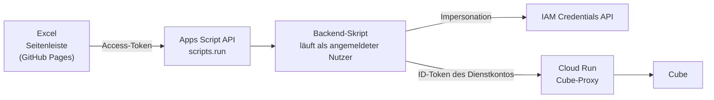
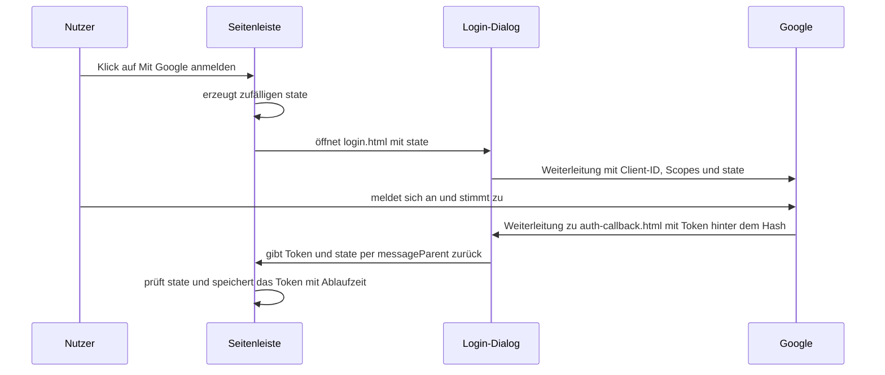
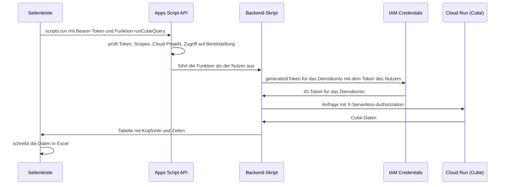

# Excel-Add-in „Schreibe Zwei“

Ein Button im Menüband (Start-Tab → Gruppe „Schreibe Zwei“ → „2 eintragen“), der eine **2** in die aktuell ausgewählte Zelle schreibt.

# Cube für Excel

Excel-Add-in (Seitenleiste), das Daten aus **Cube** in eine Tabelle schreibt. Es bietet dieselben
Funktionen wie das Google-Sheets-Add-on: Felder (Measures/Dimensions) wählen, filtern, Zeitraum
setzen, Ergebnis ab der markierten Zelle einfügen und Abfragen speichern, um sie später mit einem
Klick zu aktualisieren.

Die Anmeldung läuft über Google. Wer Daten abrufen darf, entscheidet wie beim Sheets-Add-on die
Google-Cloud-Berechtigung auf dem Dienstkonto, nicht eine Liste in diesem Projekt.

---

## Inhalt

1. [Überblick: Wie die Teile zusammenarbeiten](#1-überblick-wie-die-teile-zusammenarbeiten)
2. [Anmeldung und Zugriff im Detail](#2-anmeldung-und-zugriff-im-detail)
3. [Dateien im Repository](#3-dateien-im-repository)
4. [Einrichtung (einmalig)](#4-einrichtung-einmalig)
5. [Add-in in Excel laden](#5-add-in-in-excel-laden)
6. [Benutzung](#6-benutzung)
7. [Änderungen einspielen](#7-änderungen-einspielen)
8. [Fehlersuche](#8-fehlersuche)
9. [Sicherheit und bekannte Grenzen](#9-sicherheit-und-bekannte-grenzen)

---

## 1. Überblick: Wie die Teile zusammenarbeiten



| Teil | Aufgabe |
|---|---|
| **Seitenleiste** (`docs/`) | Oberfläche, Google-Login, schreibt die Daten mit Office.js in die Tabelle, speichert Abfragen in der Arbeitsmappe. Wird von GitHub Pages ausgeliefert. |
| **Apps Script API** | Google-Dienst, der eine Funktion eines Skripts von außen ausführt (`scripts.run`). Das Skript läuft dabei **als der angemeldete Nutzer**. |
| **Backend-Skript** (`apps-script/`) | Holt mit der Identität des Nutzers ein Token für das Dienstkonto und ruft damit Cube ab. Es ist der Server-Teil des früheren Sheets-Add-ons, ohne Sheets-Funktionen. |
| **Cloud Run / Cube** | Verlangt ein gültiges ID-Token des Dienstkontos. |

### Warum der Umweg über Apps Script?

Ein Browser-Add-in kann Cloud Run nicht direkt aufrufen. Cloud Run mit Pflicht-Anmeldung lehnt die
CORS-Vorabanfrage des Browsers immer mit 403 ab, weil sie keinen Token-Header mitschicken kann.
Apps Script ruft Cloud Run dagegen serverseitig auf, dort gibt es kein CORS.

Eine Apps-Script-**Web-App** (`doGet`/`doPost`) wäre ebenfalls ungeeignet. Sie müsste für alle
zugänglich sein, oder die Google-Cookies werden im Add-in als Drittanbieter-Cookies blockiert.
Deshalb wird die **Apps Script API** mit einem OAuth-Token genutzt.

---

## 2. Anmeldung und Zugriff im Detail

### 2.1 Ablauf beim Anmelden



- Es wird der **Implicit Flow** genutzt. Das Ergebnis ist ein **Access-Token**, das etwa eine Stunde
  gilt. Es gibt kein Refresh-Token. Danach erscheint der Login-Dialog erneut, meist reicht ein
  Klick auf das Konto.
- Die Token-Daten stehen in der URL hinter dem `#`. Dieser Teil wird nie an einen Server gesendet,
  GitHub sieht das Token also nicht.
- Der **`state`** ist ein Zufallswert. Er schützt davor, dass jemand eine fremde Anmeldung
  unterschiebt. Stimmt er bei der Rückgabe nicht, wird die Anmeldung abgelehnt.
- Das Passwort wird nur bei Google eingegeben, nie in diesem Add-in.
- Das Token liegt im `localStorage` der Seitenleiste (Schlüssel `cube.session`) und enthält die
  Berechtigungen (Scopes) aus `docs/config.js`. „Abmelden“ löscht es nur lokal.

### 2.2 Ablauf bei jeder Abfrage



1. Die Seitenleiste schickt `POST https://script.googleapis.com/v1/scripts/<Deployment-ID>:run`
   mit `Authorization: Bearer <Access-Token>` und dem Funktionsnamen (`getMeta` oder
   `runCubeQuery`).
2. Google prüft, ob das Token gültig ist, ob seine Scopes zu denen des Skripts passen, ob die
   Apps Script API im Cloud-Projekt aktiviert ist und ob das Konto die Bereitstellung nutzen darf.
3. Das Skript läuft **als der angemeldete Nutzer**. Mit `ScriptApp.getOAuthToken()` bittet es die
   IAM Credentials API um ein **ID-Token für das Dienstkonto** („Impersonation“).
4. Mit diesem ID-Token ruft das Skript Cloud Run auf (Header `X-Serverless-Authorization`).
5. Die Antwort geht zurück an die Seitenleiste, die sie mit Office.js in die Tabelle schreibt.

Das ID-Token wird pro Nutzer etwa 50 Minuten zwischengespeichert (`CacheService.getUserCache()`).

### 2.3 Wer darf was? Vier Stufen

Eine Person muss alle vier Stufen bestehen:

| Stufe | Wo eingestellt | Was sie bewirkt |
|---|---|---|
| **1. Google-Login** | Zustimmungsbildschirm in der Cloud Console | Im Testmodus nur eingetragene Testnutzer, bei „Intern“ nur Mitglieder der Organisation |
| **2. Bereitstellung** | Apps Script → Bereitstellen → „Wer hat Zugriff“ | Nur ich / nur die Domain / jeder angemeldete Google-Nutzer. Anonym ist bei der API nie möglich. |
| **3. Token-Rolle** | IAM auf dem Dienstkonto | Rolle „Service Account OpenID Connect Identity Token Creator“. **Hier wird Cube-Zugriff vergeben und entzogen.** Fehlt sie, meldet das Backend „Kein Zugriff auf Cube (403)“. |
| **4. Cloud Run** | IAM auf dem Cloud-Run-Dienst | Das **Dienstkonto** braucht `roles/run.invoker`. Der Nutzer selbst braucht das nicht. |

Cloud Run sieht nur das Dienstkonto, nicht den einzelnen Nutzer. Wer abgefragt hat, protokolliert
IAM beim Erzeugen des Tokens. Nach dem Entzug der Rolle kann ein Nutzer wegen des Zwischenspeichers
noch bis zu etwa 50 Minuten weiterarbeiten.

---

## 3. Dateien im Repository

```
excel_add_in/
├── README.md
├── docs/                      ← wird per GitHub Pages veröffentlicht
│   ├── manifest.xml           Beschreibung des Add-ins für Excel
│   ├── taskpane.html          Oberfläche der Seitenleiste
│   ├── taskpane.js            Login, Aufruf des Backends, Schreiben in Excel, gespeicherte Abfragen
│   ├── config.js              Client-ID, Deployment-ID, Scopes
│   ├── login.html             leitet im Dialog zu Google weiter
│   ├── auth-callback.html     nimmt das Token von Google entgegen und gibt es an die Seitenleiste
│   └── assets/icon-16|32|80.png
└── apps-script/               ← Kopie des Codes aus dem Apps-Script-Projekt (wird nicht ausgeführt)
    ├── Code.gs                Backend-Funktionen getMeta und runCubeQuery
    └── appsscript.json        Scopes und erlaubte Adressen des Skripts
```

Wichtige Zuordnungen:

- Die Scopes in `docs/config.js` (`SCOPE`) müssen **alle** `oauthScopes` aus
  `apps-script/appsscript.json` enthalten. Sonst lehnt `scripts.run` den Aufruf ab.
  `userinfo.email` steht nur dort, damit die Seitenleiste die E-Mail-Adresse anzeigen kann.
- Dienstkonto, Cloud-Run-URL und Cube-Pfad stehen als Konstanten am Anfang von `Code.gs`.
- Gespeicherte Abfragen liegen in den **Einstellungen der Arbeitsmappe** (`workbook.settings`,
  Schlüssel `cube.saved`) und werden mit der Datei gespeichert.

---

## 4. Einrichtung (einmalig)

### 4.1 Google Cloud Console (Projekt 554034917596)

1. **APIs aktivieren:** *Apps Script API* und *IAM Service Account Credentials API*.
2. **OAuth-Zustimmungsbildschirm:** Bei Google Workspace am besten „Intern“. Andernfalls im
   Testmodus alle Nutzer als Testnutzer eintragen. Ergänze die Bereiche `cloud-platform`,
   `script.external_request` und `userinfo.email`.
3. **OAuth-Client-ID** (Typ „Webanwendung“):
   - Autorisierte JavaScript-Quelle: `https://tobiasvoth.github.io`
   - Autorisierte Weiterleitungs-URI: `https://tobiasvoth.github.io/excel_add_in/auth-callback.html`
4. **IAM:**
   - Nutzer oder Gruppe erhalten auf dem Dienstkonto die Rolle *Service Account OpenID Connect
     Identity Token Creator*.
   - Das Dienstkonto hat `roles/run.invoker` auf dem Cloud-Run-Dienst.

### 4.2 Apps-Script-Backend

1. Auf script.google.com ein **neues, eigenständiges Projekt** anlegen. Nicht das Sheets-Add-on
   erweitern, sonst werden dessen Sheets-Berechtigungen mitverlangt.
2. Inhalt von `apps-script/Code.gs` einfügen und `appsscript.json` über Projekteinstellungen →
   „appsscript.json im Editor anzeigen“ übernehmen.
3. Projekteinstellungen → Google-Cloud-Projekt → **Projekt ändern** auf 554034917596.
4. **Bereitstellen → Neue Bereitstellung → Typ „API-Ausführbare Datei“.** Bei „Wer hat Zugriff“
   „Nur meine Domain“ oder „Jeder angemeldete Google-Nutzer“ wählen.
5. Die **Deployment-ID** kopieren (Bereitstellen → Bereitstellungen verwalten). Nicht die
   Skript-ID und nicht die ID einer Web-App-Bereitstellung.

### 4.3 Add-in-Dateien

1. In `docs/config.js` bei `DEPLOYMENT_ID` die Deployment-ID eintragen.
2. Repository-Einstellungen → Pages → Quelle: Branch `main`, Ordner `/docs`.
3. Pushen und prüfen, dass `https://tobiasvoth.github.io/excel_add_in/taskpane.html` erreichbar ist.

---

## 5. Add-in in Excel laden

Das Add-in wird über `docs/manifest.xml` eingebunden. Die Web-Dateien liegen weiter auf GitHub
Pages, Excel liest nur das Manifest.

Ist das Manifest geändert, muss `<Version>` erhöht und das Manifest neu geladen werden.
initiales Laden und aktualisieren mit folgenden Befehlen

mkdir $HOME\addin
Invoke-WebRequest -Uri https://raw.githubusercontent.com/tobiasvoth/excel_add_in/main/manifest.xml -OutFile "$HOME\addin\manifest.xml"
reg add "HKCU\Software\Microsoft\Office\16.0\WEF\Developer" /v "SchreibeZwei" /t REG_SZ /d "$HOME\addin\manifest.xml" /f


---

## 6. Benutzung

1. Auf der Registerkarte Start die Gruppe **Cube** öffnen, Seitenleiste starten.
2. Auf **Mit Google anmelden** klicken und im Dialog das Konto wählen. Beim ersten Mal die
   Berechtigungen erlauben.
3. Measures und Dimensions wählen. Nicht kombinierbare Felder (kein Join-Pfad) sind ausgegraut.
4. Optional Filter, Zeitraum und Gruppierung setzen. Mehrere Filterwerte mit Semikolon trennen.
5. Die **Zielzelle in Excel markieren** und auf *In Tabelle schreiben* klicken. Das Ergebnis
   beginnt in der markierten Zelle.
6. Mit einem Namen bei *Abfrage merken* wird die Abfrage samt Zielposition in der Arbeitsmappe
   gespeichert. *Aktualisieren* ersetzt die Daten an derselben Stelle. Bei einem Fehler bleiben die
   alten Daten stehen. Gespeicherte Abfragen werden mit der Datei gespeichert.
7. Unter *Werkzeuge* lassen sich die Cube-Übersicht und die kombinierbaren Gruppen als Tabelle
   ausgeben.

---

## 7. Änderungen einspielen

| Was geändert wurde | Was zu tun ist |
|---|---|
| `Code.gs` oder `appsscript.json` | Speichern, dann **Bereitstellungen verwalten → Stift → Neue Version → Bereitstellen**. Eine API-Ausführbare Datei läuft immer in der zuletzt *bereitgestellten* Version, nicht im Editor-Stand. Die Deployment-ID bleibt gleich. |
| Dateien in `docs/` | Pushen und kurz auf Pages warten. Bei altem Stand `?v=` an den Script-Zeilen in `taskpane.html` erhöhen und ggf. den Cache leeren. |
| `manifest.xml` | `<Version>` erhöhen und Manifest neu laden. |

Cache leeren unter Windows: Excel beenden, Inhalt von `%LOCALAPPDATA%\Microsoft\Office\16.0\Wef\`
löschen. Unter Mac: Excel beenden, Inhalt von
`~/Library/Containers/com.microsoft.Excel/Data/Library/Caches/` löschen (nicht `Documents/wef`).

Unten in der Seitenleiste steht „Build … · Deployment-ID: …“. Daran lässt sich erkennen, welche
Version geladen ist.

---

## 8. Fehlersuche

Fehler erscheinen rot in der Statuszeile unten in der Seitenleiste.

| Meldung | Ursache und Lösung |
|---|---|
| `Apps Script API has not been used in project … or it is disabled` | Apps Script API im Cloud-Projekt aktivieren und einige Minuten warten. |
| `HTTP 400 … Script ID … could not be opened` | Deployment-ID falsch oder noch der Platzhalter `DEINE_DEPLOYMENT_ID`. Prüfen, was `https://tobiasvoth.github.io/excel_add_in/config.js` ausliefert, und Cache leeren. |
| `Script function not found: runCubeQuery` (oder `getMeta`) | In der bereitgestellten Version fehlt die Funktion. Neue Version bereitstellen (siehe oben) und prüfen, dass im richtigen Projekt gearbeitet wird. |
| `Skript nicht gefunden` (404) | Deployment-ID stammt nicht von der API-Ausführbaren Datei, oder das Projekt ist nicht mit dem Cloud-Projekt 554034917596 verknüpft. |
| `Zugriff verweigert` (403) | Konto darf die Bereitstellung nicht nutzen („Wer hat Zugriff“), Apps Script API nicht aktiv oder beim Login wurden nicht alle Berechtigungen erlaubt. Abmelden und neu anmelden. |
| `Kein Zugriff auf Cube (403)` | Die Rolle „Service Account OpenID Connect Identity Token Creator“ auf dem Dienstkonto fehlt. Beim Admin anfragen. |
| `Token-Fehler …` | Meist ist die IAM Service Account Credentials API nicht aktiv oder das Dienstkonto in `Code.gs` falsch geschrieben. |
| Login-Dialog zeigt `redirect_uri_mismatch` | Weiterleitungs-URI in der OAuth-Client-ID ergänzen (siehe 4.1). |
| Login-Dialog zeigt „Zugriff blockiert“ oder „App nicht verifiziert“ | Nutzer als Testnutzer eintragen oder den Zustimmungsbildschirm auf „Intern“ stellen. |
| `disallowed_useragent` | Der eingebettete Browser der Excel-Version wird von Google nicht akzeptiert. Aktuelles Microsoft 365 oder Excel im Browser verwenden. |
| `Anmeldung abgebrochen` | Dialogfenster wurde geschlossen, nochmals anmelden. |
| `Zielblatt existiert nicht mehr` | Das Blatt einer gespeicherten Abfrage wurde gelöscht. Abfrage löschen und neu anlegen. |

---

## 9. Sicherheit und bekannte Grenzen

- **Der Code in `docs/` ist öffentlich.** Client-ID und Deployment-ID sind keine Geheimnisse. Der
  Schutz liegt bei Google und IAM (die vier Stufen oben), nicht im Add-in-Code.
- **Der Access-Token ist mächtig.** Er enthält den Scope `cloud-platform` und liegt für etwa eine
  Stunde im Browser-Speicher der Seitenleiste. Schreibzugriff auf das Repository (Ordner `docs/`)
  sollte deshalb nur vertrauenswürdigen Personen gegeben werden. Widerrufen lässt sich ein Token
  unter myaccount.google.com in den Sicherheitseinstellungen für Apps mit Kontozugriff.
- **Kein Refresh-Token:** Nach etwa einer Stunde ist ein neuer Login nötig.
- **Antwortgröße:** Die Apps Script API kann sehr große Antworten begrenzen. Das Standardlimit von
  1000 Zeilen ist unkritisch, bei sehr großen Abfragen kann ein Fehler auftreten.
- **Nicht mit echten Systemen getestet:** Der Ablauf wurde mit simulierten Antworten geprüft. Eine
  Annahme ist, dass `ScriptApp.getOAuthToken()` unter `scripts.run` einen Token mit
  `cloud-platform` liefert. Meldet das Backend einen Token-Fehler, ist das die erste Stelle zum
  Prüfen.
